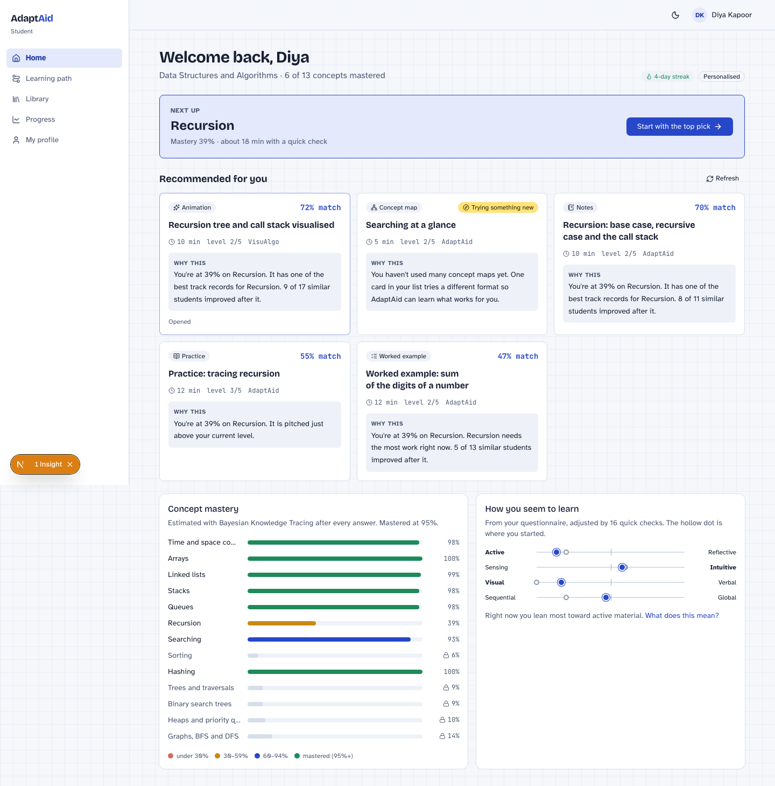

# AdaptAid

**An intelligent adaptive learning framework for teaching-aid recommendation.**
NTCC minor project (see [`Synopsis.MD`](Synopsis.MD)).

AdaptAid works out what each student does not know yet and which kinds of teaching aid
actually help them. It then recommends the next video, animation, worked example, notes or
exercise, with a reason, and re-checks after every aid. Teachers see the same intelligence at
class level: a mastery heatmap, students who need help (and why), and which teaching aids to
bring to the next lecture.



## How it works

```
Diagnose ─▶ Recommend ─▶ Learn (use an aid) ─▶ Quick check ─▶ Update the learner model ─┐
               ▲                                                                          │
               └──────────────────────────────────────────────────────────────────────────┘
```

| Synopsis promise | What implements it |
|---|---|
| Analyse **student performance** | Bayesian Knowledge Tracing per concept, updated after every answer (`backend/engine/bkt.py`) |
| …and **learning styles** | Felder–Silverman preference vector: a questionnaire prior, then learned from outcomes (`engine/style.py`) |
| **Collect data, categorise teaching aids** | Event logging; 94 aids tagged with format, concept, level and style vector ([rubric](content/dsa/RUBRIC.md)) |
| **ML learner profiles** | K-Means personas, risk flags, BKT parameters fitted from data (`engine/profiling.py`, nightly jobs) |
| **Hybrid filtering** | Need + style + level (content/knowledge-based) + collaborative filtering + aid helpfulness, with weights that switch by data phase; MMR diversity, an exploration slot, and explanations (`engine/hybrid.py`, `rerank.py`, `cf.py`, `explain.py`) |
| **Evaluate and refine** | Learner simulator; ASSISTments and OULAD benchmarks; pre-registered A/B pilot (`research/`, `docs/STUDY_PROTOCOL.md`) |

Key design choices: aid helpfulness is the **residual gain** (quick-check result minus what BKT
expected), not BKT's own estimate, which its learn step inflates. Collaborative filtering
learns from that outcome rather than from clicks. The control arm of the pilot sees the same
screens and aids, only in course-plan order.

## Headline results (offline)

| Evaluation | Result |
|---|---|
| Simulated learners, adaptive vs fixed course plan | Area under the learning curve **+0.03 to +0.05**, 95% CI above zero at every level of "how much format matters" (8 paired seeds, synthetic and real course) |
| Style-matching signal alone | Not distinguishable from zero unless format truly matters a lot, consistent with the learning-styles literature, so it is treated as a preference, not a label |
| Knowledge tracing, ASSISTments 2009 (40 skills, 5-fold by student) | Our BKT ROC-AUC **0.71** vs 0.60 for the per-skill baseline. Head to head with pyBKT's EM fit (5 largest skills): 0.687 vs 0.693 |
| At-risk after 6 weeks, OULAD (train 2013 / test 2014) | Random forest ROC-AUC **0.77**, PR-AUC 0.75 |
| Next course materials, OULAD (time split) | Item-kNN NDCG@5 **0.30** vs popular 0.24 and random 0.07 |

All numbers are regenerated by `make research` and written up in
[`docs/report-assets/results.md`](docs/report-assets/results.md).

## Quick start (local)

Prerequisites: Docker, Python 3.11, Node 22 or newer.

```bash
cp .env.example .env
make install          # backend venv + frontend packages
make db               # PostgreSQL in Docker (port 5434)
make migrate
make demo             # load the course, simulate a 4-week demo semester (about 10 min), import results
make dev              # API on :8000, web on :3000
```

Open http://localhost:3000 and sign in (password `demo-pass-2026`):

| Account | What you see |
|---|---|
| `student@adaptaid.demo` | Diya, stuck on recursion: recommendations with reasons, the learning path, progress |
| `teacher@adaptaid.demo` | Demo CSE-3A with 61 students: heatmap, risk, class aid suggestions |
| `admin@adaptaid.demo` | Users, jobs, the model report, pilot settings |

`cd backend && .venv/bin/python -m app.cli demo-check` confirms everything a demo relies on.
`adaptaid reset-demo --force` then `make demo` starts over.

## Repository

```
backend/        FastAPI app (app/) + recommendation engine (engine/, pure Python) + tests
frontend/       Next.js 16 app, Playwright journeys (e2e/)
content/dsa/    the demo course: 13 concepts, 94 aids, 248 questions, questionnaire, SUS
research/       simulation study, ASSISTments/OULAD evaluations, pilot analysis
docs/           DEPLOY.md, STUDY_PROTOCOL.md, report-assets/ (diagrams, results, screenshots)
```

## Tests

| Command | What runs |
|---|---|
| `make test` | 85+ backend tests: engine maths (incl. a pyBKT reference), API, learning loop, pilot study, jobs on committed data, research analysis |
| `make e2e` | Playwright browser journeys (student, teacher, admin, auth) against a production build |
| `make contract` | Proxy contract tests (cookies, gzip, 204, uploads, downloads, redirects) |
| `make ci` | Lint, typecheck, tests, migration and API-schema drift checks, production build (also run by GitHub Actions) |

## Research and the pilot study

- `make research` regenerates every offline result and figure and checks tripwires (implausible
  numbers fail the run). `research/notebooks/results.ipynb` presents them all.
- The pyBKT head-to-head runs best on Colab (its C++ engine needs OpenMP, which builds on Linux):
  open `research/notebooks/pybkt_colab.ipynb` in Colab, run all, put the downloaded
  `pybkt_predictions.csv` in `research/outputs/`, then run
  `backend/.venv/bin/python -m research.src.bkt_eval --pybkt-csv research/outputs/pybkt_predictions.csv`.
- The pilot study (A/B, pre/post test, SUS) is described in
  [`docs/STUDY_PROTOCOL.md`](docs/STUDY_PROTOCOL.md). Analyse the export with
  `backend/.venv/bin/python -m research.src.pilot_analysis pilot_study.csv`.

## Deploying

Docker Compose with Caddy (automatic HTTPS) on any small VPS: see [`docs/DEPLOY.md`](docs/DEPLOY.md).
`docker compose --profile prod up -d --build` brings up the database, API, web app and proxy;
migrations run on start and nightly jobs run inside the API.

## Report material

[`docs/report-assets/`](docs/report-assets/): architecture, DFD levels 0 and 1, use-case,
sequence and deployment diagrams (Mermaid), the ER diagram and data dictionary generated from
the models, content statistics, results tables, figures, screenshots, the OpenAPI schema, and
appendices (questionnaire, consent text, SUS). Regenerate with
`backend/.venv/bin/python -m research.src.report_assets` and `make screenshots`.

## Credits and licences

- ASSISTments 2009-2010 skill builder data (Feng, Heffernan & Koedinger), used for research.
- OULAD (Kuzilek, Hlosta & Zdrahal, 2017, *Scientific Data*), CC BY 4.0.
- External teaching aids are links to their owners' sites (CS50, mycodeschool, WilliamFiset,
  HackerRank, Computerphile, VisuAlgo, USFCA visualizations, Programiz, Wikipedia); nothing is re-hosted.
- The preference questionnaire is AdaptAid's own. It is not the Index of Learning Styles
  (© Richard Felder), but students who took the ILS can enter their scores.
