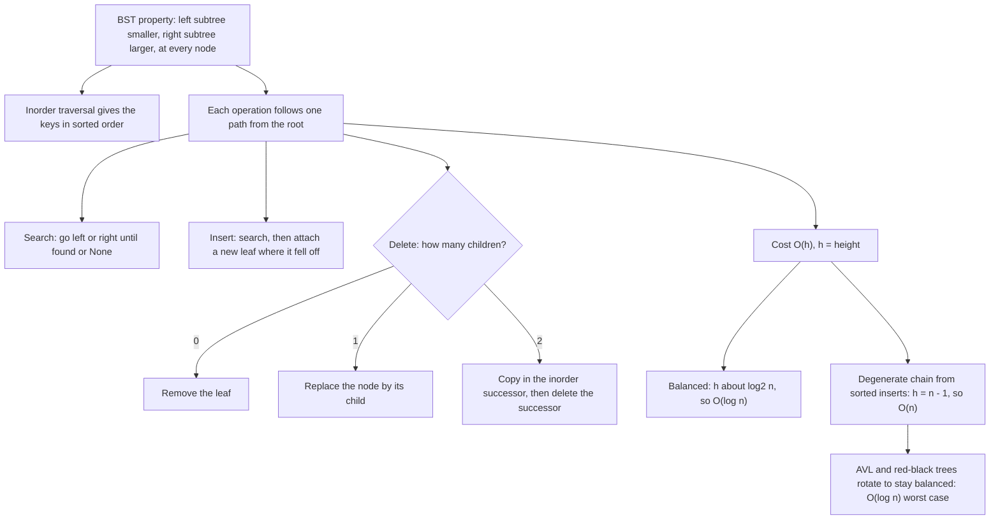

# Binary search trees at a glance

**Takeaways**

- The BST property holds for **whole subtrees**, not just a node and its two children.
- **Search, insert and delete** all walk a single root-to-leaf path, so they cost **O(h)**.
- **Height decides everything**: about log₂ n when balanced, n − 1 when keys arrive in sorted order.
- Deleting a node with **two children** borrows its **inorder successor**, the leftmost node of its right subtree.
- **Inorder traversal** of a BST is sorted, which is also a quick way to check that a tree really is a BST.
