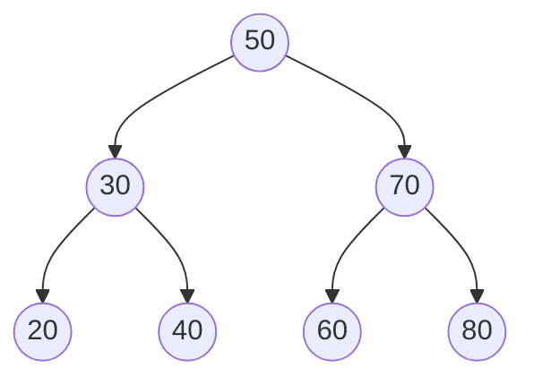

# Binary search trees

Binary search on a sorted array finds a key in O(log n), but inserting or deleting means shifting up to *n* elements. A **binary search tree** (BST) keeps keys in a linked binary tree instead, so search, insert and delete can all follow a single path from the root.

## The BST property

For **every** node, all keys in its **left subtree are smaller** and all keys in its **right subtree are larger**. (We assume distinct keys.)



Because of this rule, an **inorder traversal** (left, node, right) lists the keys in **sorted order**: 20 30 40 50 60 70 80.

## Operations

**Search.** Start at the root. If the key is smaller go left, if larger go right, until you find it or step onto `None` (not present). Each comparison discards a whole subtree, just like binary search.

```python
def search(node, key):
    while node is not None and node.key != key:
        node = node.left if key < node.key else node.right
    return node            # the node, or None if the key is absent
```

**Insert.** Search for the key; the `None` where the search falls off the tree is exactly where the new leaf belongs.

**Delete** has three cases:

1. **Leaf**: just remove it.
2. **One child**: replace the node by its child.
3. **Two children**: copy in the key of its **inorder successor** (the smallest key in its right subtree: go right once, then left as far as possible), then delete the successor from the right subtree. The successor has no left child, so that second delete is case 1 or 2.

## Cost depends on the height

Each operation walks one root-to-leaf path, so it costs **O(h)**, where *h* is the height.

- A **balanced** tree has h ≈ log₂ n: about 20 steps for a million keys.
- Inserting keys **in sorted order** builds a **degenerate** tree, a chain where every node has only a right child: h = n − 1, and every operation degrades to **O(n)**, no better than a linked list.

**Self-balancing** BSTs such as **AVL trees** and **red-black trees** fix this. After each insert or delete they restore balance with small local *rotations*, keeping h = O(log n), so every operation is O(log n) in the worst case. Java's `TreeMap`, for example, is a red-black tree.

## Common mistake

Checking only a node's **immediate children** is not enough. In the tree with root 10, left child 5 and 5's right child 12, every parent–child pair looks fine, but 12 sits in 10's *left* subtree while being larger than 10, so it is not a BST. Search for 12 would go right at 10 and never find it.
