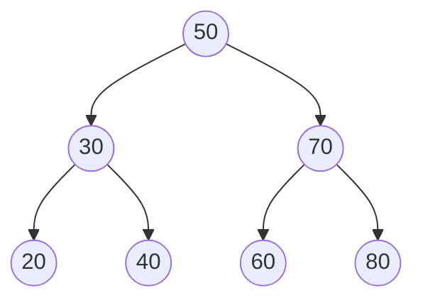
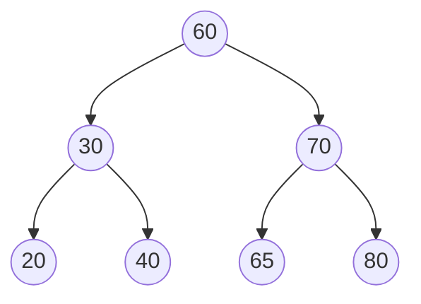

# Worked example: a BST of ticket numbers

**Problem.** A help desk keeps open ticket numbers in a binary search tree. Tickets 50, 30, 70, 20, 40, 60, 80 arrive in that order. Then the desk (a) looks up ticket 65, (b) opens ticket 65, and (c) closes ticket 50. Show the tree after each step and count the comparisons.

## The code we will trace

```python
class Node:
    def __init__(self, key):
        self.key, self.left, self.right = key, None, None

def insert(node, key):
    if node is None:
        return Node(key)                     # fell off the tree: new leaf here
    if key < node.key:
        node.left = insert(node.left, key)
    elif key > node.key:
        node.right = insert(node.right, key)
    return node

def search(node, key):
    while node is not None and node.key != key:
        node = node.left if key < node.key else node.right
    return node

def delete(node, key):
    if node is None:
        return None
    if key < node.key:
        node.left = delete(node.left, key)
    elif key > node.key:
        node.right = delete(node.right, key)
    else:
        if node.left is None:                # leaf or only a right child
            return node.right
        if node.right is None:               # only a left child
            return node.left
        succ = node.right                    # two children: find the successor
        while succ.left is not None:
            succ = succ.left
        node.key = succ.key                  # copy it up ...
        node.right = delete(node.right, succ.key)   # ... and remove the original
    return node
```

## Step 1: build the tree

Each key walks down from the root, turning left when smaller and right when larger, and becomes a leaf where it falls off.

| Insert | Path taken | Becomes |
|---|---|---|
| 50 | (empty tree) | root |
| 30 | 50 → left | left child of 50 |
| 70 | 50 → right | right child of 50 |
| 20 | 50 → left, 30 → left | left child of 30 |
| 40 | 50 → left, 30 → right | right child of 30 |
| 60 | 50 → right, 70 → left | left child of 70 |
| 80 | 50 → right, 70 → right | right child of 70 |



## Step 2: search for 65

| At node | Compare | Go |
|---|---|---|
| 50 | 65 > 50 | right |
| 70 | 65 < 70 | left |
| 60 | 65 > 60 | right: `None` |

After **3 comparisons** the search steps onto `None`, so `search(root, 65)` returns `None`: ticket 65 is not in the tree. We never looked at 20, 30, 40 or 80.

## Step 3: insert 65

`insert` follows exactly the same path and puts the new leaf where the search fell off: the **right child of 60**. The height grows from 2 to 3.

## Step 4: delete 50 (two children)

1. 50 has two children, so find its **inorder successor**: go right once (70), then left as far as possible (60). The successor is **60**.
2. Copy 60 into the root.
3. Delete the old 60 from the right subtree. It has one child (65), so 65 takes its place as 70's left child.



## Step 5: check the result

An inorder traversal must still be sorted: **20 30 40 60 65 70 80**. It is, so the BST property survived the delete. The successor was the right choice because it is larger than everything on the left and smaller than everything else on the right.

## Step 6: cost

Every operation followed one path from the root, so each costs **O(h)**. This tree is balanced (h = 2 after the delete), so about log₂ n comparisons. Had the tickets arrived in sorted order (20, 30, 40, ...), the tree would be a chain of height 6 and searching for 80 would take 7 comparisons: **O(n)** in the worst case.
