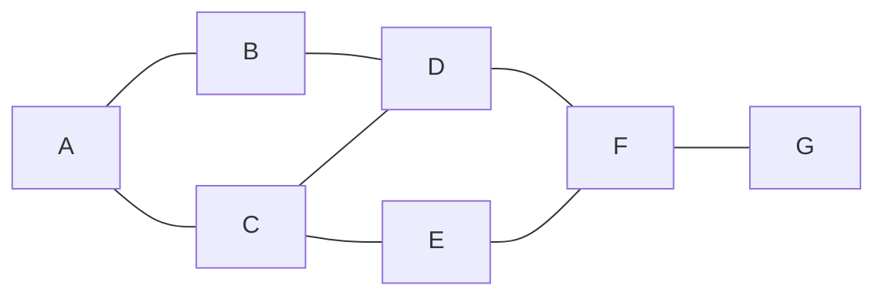

# Worked example: the fewest stops on a metro map

**Problem.** A small metro network has seven stations, A to G, and these two-way connections: A–B, A–C, B–D, C–D, C–E, D–F, E–F, F–G. A passenger at **A** wants to reach **G** with the **fewest stops**. Find the route and its length.



## Step 1: choose a representation

The network is small and sparse, so an adjacency list (a dict of lists) is ideal. Each connection is two-way, so it appears in both stations' lists.

```python
graph = {
    "A": ["B", "C"],
    "B": ["A", "D"],
    "C": ["A", "D", "E"],
    "D": ["B", "C", "F"],
    "E": ["C", "F"],
    "F": ["D", "E", "G"],
    "G": ["F"],
}
```

## Step 2: choose the algorithm

Every connection counts the same (one stop), so the graph is **unweighted**. "Fewest stops" means fewest edges, which is exactly what **BFS** finds. To recover the route, not just its length, record each station's **parent**: the station it was discovered from.

```python
from collections import deque

def bfs_path(graph, start, goal):
    parent = {start: None}          # doubles as the visited set
    queue = deque([start])
    while queue:
        v = queue.popleft()
        if v == goal:
            break
        for w in graph[v]:
            if w not in parent:     # first discovery = shortest way to w
                parent[w] = v
                queue.append(w)
    if goal not in parent:
        return None                 # goal is unreachable
    path = []
    while goal is not None:         # walk back from the goal to the start
        path.append(goal)
        goal = parent[goal]
    return path[::-1]
```

## Step 3: trace the queue

| Step | Dequeue | Newly discovered (parent) | Queue afterwards |
|---|---|---|---|
| 1 | A | B (A), C (A) | B, C |
| 2 | B | D (B) | C, D |
| 3 | C | E (C) | D, E |
| 4 | D | F (D) | E, F |
| 5 | E | none (C and F already seen) | F |
| 6 | F | G (F) | G |
| 7 | G | goal reached: stop | |

The stations come out of the queue in rings: A (0 stops), then B and C (1), then D and E (2), then F (3), then G (4).

## Step 4: rebuild the route

Follow the parents back from G: G ← F ← D ← B ← A. Reversed, the route is **A → B → D → F → G: 4 stops**. Other routes of the same length exist (A → C → E → F → G); BFS returns the one it discovered first, which depends on the order of the neighbour lists.

## Step 5: why not DFS?

A recursive DFS from A with the same lists visits A, B, D, C, E, F, G. Following its parent links to G gives A → B → D → C → E → F → G: **6 stops**. DFS reaches every station, but it commits to one long path before trying others, so it does not find the shortest route.

## Step 6: cost

Each station is enqueued at most once and each adjacency list is scanned once, so BFS is **O(V + E)** time; here V = 7 and E = 8. The `parent` dict and the queue use **O(V)** extra space. Rebuilding the path is O(length of the path).
