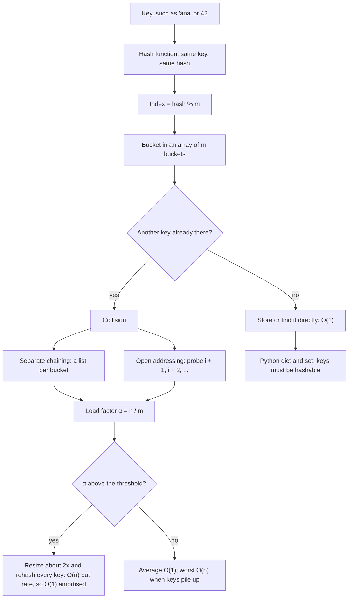

# Hashing at a glance

**Takeaways**

- A hash table is an **array plus a hash function**: the function turns a key into an index, so a lookup jumps straight to one bucket.
- **Collisions are normal**, not errors. Chaining keeps colliding keys in a list; open addressing moves them to another free slot and needs tombstones for deletion.
- The **load factor** n / m controls speed. Keep it low by **resizing and rehashing** every key, since each index depends on m.
- **O(1) is an average**, resting on a hash function that spreads keys out. If all keys collide, every operation degrades to **O(n)**.
- Python's `dict` and `set` are hash tables; their keys must be **immutable** (hashable), and they are not kept in sorted order.
