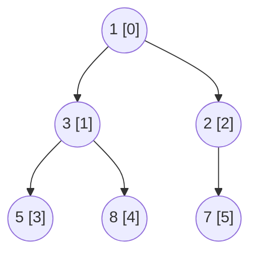

# Heaps and priority queues

A **priority queue** always hands you the most important item next: the most urgent patient, the next event in a simulation, the nearest city in Dijkstra's algorithm. It needs three operations: **insert**, **peek** at the minimum and **extract** the minimum. A sorted list makes extract cheap but insert O(n); a **binary heap** makes both O(log n).

## What a binary heap is

A (min-)heap is a binary tree with two rules:

1. **Shape**: it is a **complete** binary tree. Every level is full except possibly the last, which is filled from the left.
2. **Heap property**: every parent is **≤ its children**. So the minimum is always at the root.

A heap is *not* sorted: it only orders each parent against its own children, so siblings can be in any order. A **max-heap** flips the rule (parent ≥ children).

## Stored in an array

Because the tree is complete there are no gaps, so it fits in a plain list with no pointers. With 0-based indexes, the node at index `i` has

- left child at `2*i + 1`, right child at `2*i + 2`
- parent at `(i - 1) // 2`



The list `[1, 3, 2, 5, 8, 7]` is this tree read level by level. A complete tree with *n* nodes has height ⌊log₂ n⌋.

## Operations

- **Peek**: return `a[0]`. **O(1)**.
- **Insert**: append at the end (the next free leaf), then **sift up**: swap with the parent while smaller than it. **O(log n)**.
- **Extract-min**: take `a[0]`, move the last element to the root, then **sift down**: swap with the *smaller* child while larger than it. **O(log n)**.
- **Build-heap** from *n* items: sift down every internal node, from index `n//2 - 1` back to 0. **O(n)**, not O(n log n): half the nodes are leaves and do no work, and most of the others are near the bottom, so their sift-downs are short.
- **Heapsort**: build a max-heap, then repeatedly swap the root with the last element and sift down. **O(n log n)** time, O(1) extra space, not stable.

## Python's heapq

`heapq` turns an ordinary list into a **min-heap**:

```python
import heapq

tasks = [5, 1, 8, 3]
heapq.heapify(tasks)          # O(n), in place
heapq.heappush(tasks, 2)      # O(log n)
print(tasks[0])               # 1: peek at the minimum
print(heapq.heappop(tasks))   # 1, then 2, 3, 5, 8 on later pops
```

There is no max-heap version: push `-x` and negate what you pop.

## Common mistakes

- Expecting the list to be sorted, or searching it for an arbitrary key: that is **O(n)**; heaps only make the minimum fast.
- When sifting down, swapping with the **left** child instead of the **smaller** child, which breaks the heap property.
