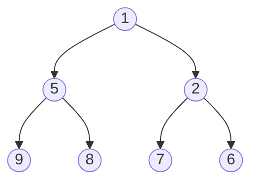

# Worked example: a triage queue as a min-heap

**Problem.** An emergency department ranks waiting patients by urgency, where **1 is the most urgent**. At the start of a shift seven patients are waiting with urgencies `[9, 5, 7, 1, 8, 2, 6]`. Then a new patient with urgency **3** arrives, and then a doctor becomes free and calls the most urgent patient. Keep the queue in a min-heap and show the array after every step.

## The code we will trace

```python
def sift_down(a, i):
    n = len(a)
    while True:
        left, right = 2 * i + 1, 2 * i + 2
        smallest = i
        if left < n and a[left] < a[smallest]:
            smallest = left
        if right < n and a[right] < a[smallest]:
            smallest = right
        if smallest == i:              # parent is <= both children: done
            return
        a[i], a[smallest] = a[smallest], a[i]
        i = smallest

def sift_up(a, i):
    while i > 0:
        parent = (i - 1) // 2
        if a[i] >= a[parent]:          # parent is already smaller: done
            return
        a[i], a[parent] = a[parent], a[i]
        i = parent

def build_heap(a):
    for i in range(len(a) // 2 - 1, -1, -1):   # last internal node down to the root
        sift_down(a, i)

def push(a, x):
    a.append(x)
    sift_up(a, len(a) - 1)

def pop_min(a):
    top, last = a[0], a.pop()
    if a:
        a[0] = last
        sift_down(a, 0)
    return top
```

## Step 1: build the heap

With *n* = 7 the internal nodes are indexes 2, 1, 0 (`7 // 2 - 1 = 2`). Leaves (3 to 6) are already one-node heaps, so we start at index 2 and work back to the root.

| Sift down at | Value | Swaps | Array afterwards |
|---|---|---|---|
| index 2 | 7 | 7 ↔ 2 | `[9, 5, 2, 1, 8, 7, 6]` |
| index 1 | 5 | 5 ↔ 1 | `[9, 1, 2, 5, 8, 7, 6]` |
| index 0 | 9 | 9 ↔ 1, then 9 ↔ 5 | `[1, 5, 2, 9, 8, 7, 6]` |

At index 0, 9 is compared with its children 1 and 2 and swapped with the **smaller** one, 1. Now 9 is at index 1, whose children are 5 (index 3) and 8 (index 4); it swaps with 5 and lands at index 3, a leaf.



Every parent is ≤ its children, and the most urgent patient (1) is at the root.

## Step 2: a patient with urgency 3 arrives

`push(a, 3)` appends 3 at index 7, whose parent is index `(7 - 1) // 2 = 3`.

| 3 is at | Parent | Compare | Action |
|---|---|---|---|
| index 7 | 9 (index 3) | 3 < 9 | swap |
| index 3 | 5 (index 1) | 3 < 5 | swap |
| index 1 | 1 (index 0) | 3 ≥ 1 | stop |

Array: `[1, 3, 2, 5, 8, 7, 6, 9]`. Two swaps, along one path from a leaf toward the root.

## Step 3: the doctor calls the next patient

`pop_min(a)` returns **1**. The last element, 9, moves to the root and sifts down:

| 9 is at | Children | Smaller child | Action |
|---|---|---|---|
| index 0 | 3, 2 | 2 (index 2) | swap |
| index 2 | 7, 6 | 6 (index 6) | swap |
| index 6 | none | | stop |

Array: `[2, 3, 6, 5, 8, 7, 9]`. The next patient to be called will be urgency 2.

## Step 4: check against heapq

```python
import heapq
h = [9, 5, 7, 1, 8, 2, 6]
heapq.heapify(h)          # [1, 5, 2, 9, 8, 7, 6]
heapq.heappush(h, 3)      # [1, 3, 2, 5, 8, 7, 6, 9]
print(heapq.heappop(h))   # 1, leaving [2, 3, 6, 5, 8, 7, 9]
```

The library gives exactly the same arrays here. (When keys repeat, heapq can break ties between equal keys differently, so its array may differ from a hand trace while still being a valid heap.)

## Step 5: cost

Building the heap did 4 swaps for 7 items; in general build-heap is **O(n)**. Each push and pop moved along one root-to-leaf path, at most ⌊log₂ n⌋ swaps, so each is **O(log n)**. A sorted list would need O(n) to insert the new patient in the right place.
