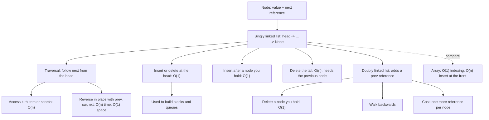

# Linked lists at a glance

**Takeaways**

- A linked list trades **O(1) indexing** for **O(1) insertion and deletion** wherever you already hold a reference.
- Every operation is a matter of **re-pointing references**; do it in an order that never loses the rest of the list.
- **Singly linked** lists are cheap at the head; **doubly linked** lists can also remove any node they hold in O(1) and walk backwards.
- Finding a position is the expensive part: walking there costs O(n) even if the change itself is O(1).
- Always test the **empty list**, the **head** and the **tail** as separate cases.
