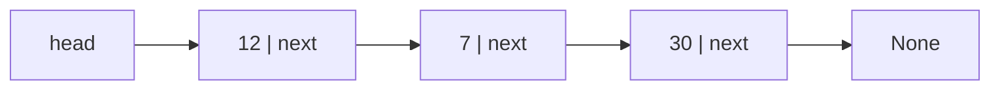

# Linked lists

A **linked list** stores a sequence as separate **nodes** that can sit anywhere in memory. Each node holds a value and a reference to the **next** node. The list itself only remembers the first node, the **head**; the last node's `next` is `None`.



```python
class Node:
    def __init__(self, val, next=None):
        self.val = val
        self.next = next

head = Node(12, Node(7, Node(30)))   # 12 -> 7 -> 30
```

## Traversal

There is no address formula as with arrays. To reach the k-th node you follow `next` k times from the head:

```python
cur = head
while cur is not None:
    print(cur.val)
    cur = cur.next
```

## Key operations (singly linked)

| Operation | Cost | Why |
|---|---|---|
| access the k-th item | O(k), O(n) worst | walk from the head |
| search for a value | O(n) | walk until found |
| insert or delete at the head | O(1) | change one or two references |
| insert after a node you already hold | O(1) | no shifting |
| insert at the tail | O(1) with a `tail` reference, else O(n) | |
| delete the tail | O(n) | you need the node *before* it |

To insert `new` after `cur`: first `new.next = cur.next`, then `cur.next = new`. To delete the node after `cur`: `cur.next = cur.next.next`.

## Doubly linked lists

Each node also stores `prev`. You can walk backwards, and you can delete a node you hold in O(1), because it knows its neighbours: `x.prev.next = x.next` and `x.next.prev = x.prev`. The price is one more reference per node and more links to keep consistent.

## Linked list versus array

| | Array (Python `list`) | Linked list |
|---|---|---|
| read item i | O(1) | O(n) |
| insert/delete at the front | O(n), shifting | O(1) |
| memory | compact, cache-friendly | extra reference(s) per node |
| growing | occasional resize and copy | one node at a time |

Choose a linked list when you mostly insert and delete at the ends, or next to nodes you already hold, and rarely need item *i*. Stacks and queues are classic examples.

## Common mistakes

- **Wrong pointer order.** Writing `cur.next = new` before `new.next = cur.next` makes `new` point to itself, and the rest of the list is lost.
- **Forgetting edge cases:** the empty list (`head is None`) and changes at the head, where `head` itself must be updated.
