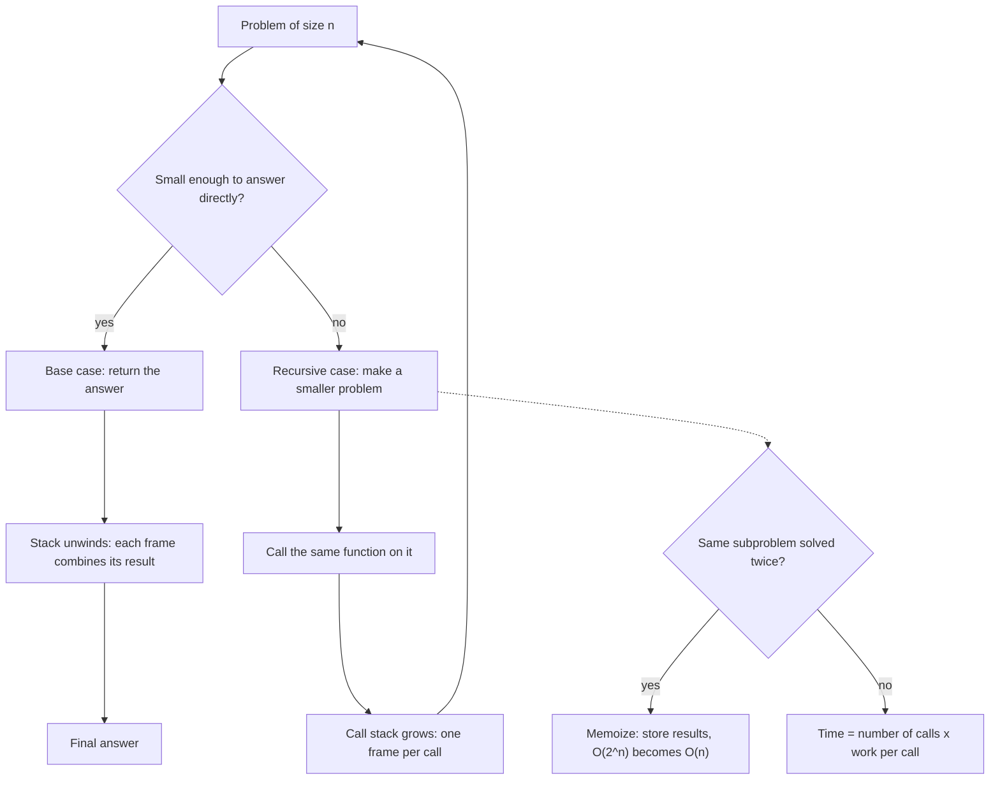

# Recursion at a glance

**Takeaways**

- Every recursive function needs a **base case** and a **recursive case that moves toward it**.
- The **call stack** holds one frame per active call, so depth costs memory: O(depth) space.
- **Calls go down, answers come back up**: the combine step runs while the stack unwinds.
- **Overlapping subproblems** (naive Fibonacci) make recursion exponential; **memoization** fixes that.
- Anything recursive can be written with a loop and an explicit stack. Prefer the loop when inputs can be very deep.
