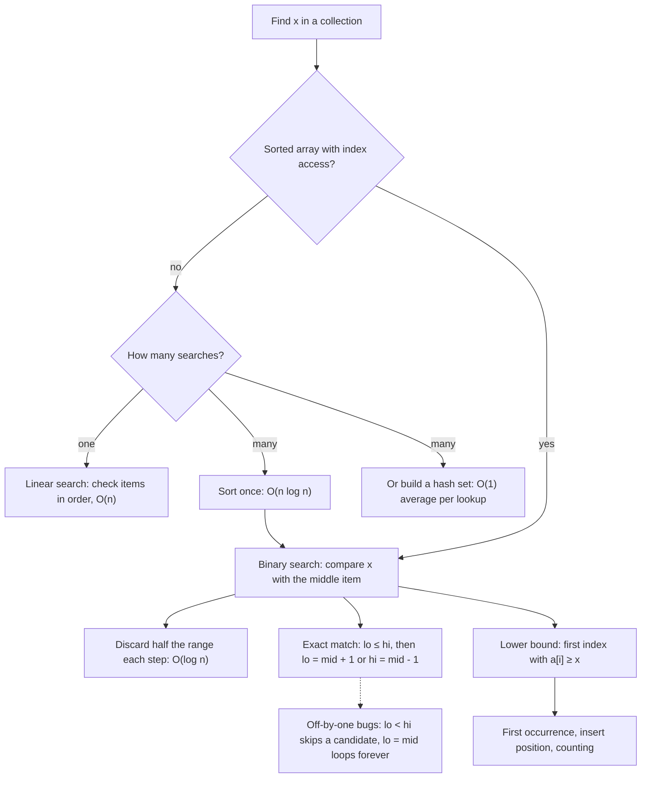

# Searching at a glance

**Takeaways**

- **Linear search** works on anything and costs O(n); it is the right choice for a single search in unsorted data.
- **Binary search** needs two things: **sorted** data and **O(1) access to any index**. Without both it is either wrong or no faster.
- Halving gives **O(log n)**: doubling the input adds only one more comparison.
- Most binary search bugs are **boundary bugs**. Fix what `lo` and `hi` mean, then make the loop condition and the updates match.
- The **lower bound** (`bisect_left`) turns binary search into a tool for first occurrences, insertion points and "how many are smaller than x?" questions.
