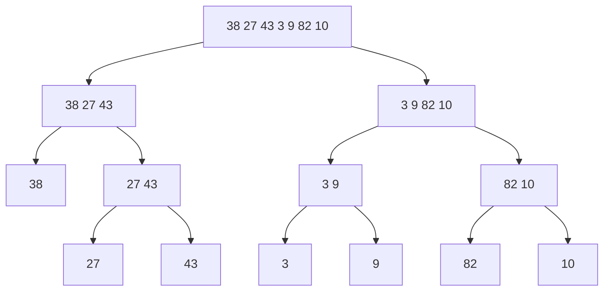

# Worked example: merge sort step by step

**Problem.** Sort `[38, 27, 43, 3, 9, 82, 10]` with merge sort, count the comparisons it makes, and see where O(n log n) comes from.

## Step 1: the idea

A list with 0 or 1 items is already sorted: that is the base case. Any longer list is split in half, each half is sorted by a recursive call, and the two sorted halves are merged.

## Step 2: the code

Merging two sorted lists only ever compares their **front** items: take the smaller one and move on. Using `<=` takes from the left list on ties, which keeps the sort stable.

```python
def merge(left, right):
    merged = []
    i = j = 0
    while i < len(left) and j < len(right):
        if left[i] <= right[j]:          # <= keeps equal items in order: stable
            merged.append(left[i])
            i += 1
        else:
            merged.append(right[j])
            j += 1
    merged.extend(left[i:])              # one list is used up,
    merged.extend(right[j:])             # so copy what is left of the other
    return merged

def merge_sort(a):
    if len(a) <= 1:                      # base case
        return a
    mid = len(a) // 2
    return merge(merge_sort(a[:mid]), merge_sort(a[mid:]))
```

## Step 3: split down to single items

`mid = len(a) // 2`, so for an odd length the left half is the smaller one.



## Step 4: merge back up

The merges happen in this order as the recursive calls return:

| # | Merge | Comparisons | Result |
|---|---|---|---|
| 1 | `[27]` + `[43]` | 1 | `[27, 43]` |
| 2 | `[38]` + `[27, 43]` | 2 | `[27, 38, 43]` |
| 3 | `[3]` + `[9]` | 1 | `[3, 9]` |
| 4 | `[82]` + `[10]` | 1 | `[10, 82]` |
| 5 | `[3, 9]` + `[10, 82]` | 2 | `[3, 9, 10, 82]` |
| 6 | `[27, 38, 43]` + `[3, 9, 10, 82]` | 6 | `[3, 9, 10, 27, 38, 43, 82]` |

Here is merge 6 in detail:

| Compare | Take | Merged so far |
|---|---|---|
| 27 vs 3 | 3 | 3 |
| 27 vs 9 | 9 | 3, 9 |
| 27 vs 10 | 10 | 3, 9, 10 |
| 27 vs 82 | 27 | 3, 9, 10, 27 |
| 38 vs 82 | 38 | 3, 9, 10, 27, 38 |
| 43 vs 82 | 43 | 3, 9, 10, 27, 38, 43 |
| left list is empty | copy 82, no comparison | 3, 9, 10, 27, 38, 43, 82 |

## Step 5: result and cost

Result: `[3, 9, 10, 27, 38, 43, 82]` after 13 comparisons in total.

- **Time.** Halving reaches single items after about log₂ n levels (3 here). At each level the merges together handle every item once, which is O(n) work per level. Total: **O(n log n)**, and that holds for sorted, reversed and random input alike.
- **Space.** Each merge builds a new list, so merge sort needs **O(n)** extra memory, plus O(log n) for the recursion stack.
- **Stability.** Because `merge` uses `<=`, an item from the left half is always taken before an equal item from the right half, so equal items never overtake each other.

**Try it yourself:** sort `[5, 1, 4, 2]` the same way. You should get `[1, 2, 4, 5]` after 1 + 1 + 3 = 5 comparisons.
