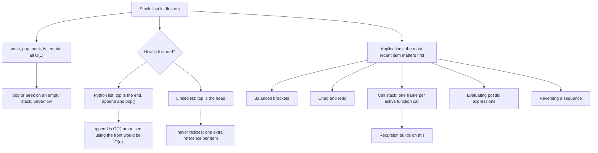

# Stacks at a glance

**Takeaways**

- A stack only gives access to its **top**: push, pop and peek are all **O(1)**.
- **LIFO** means items come out in the reverse of the order they went in.
- Use the **end** of a Python list, or the **head** of a linked list, as the top; the other end costs O(n).
- Reach for a stack whenever the **most recent unfinished thing** must be handled first: matching brackets, undo, function calls.
- Always check for an **empty** stack before popping or peeking.
