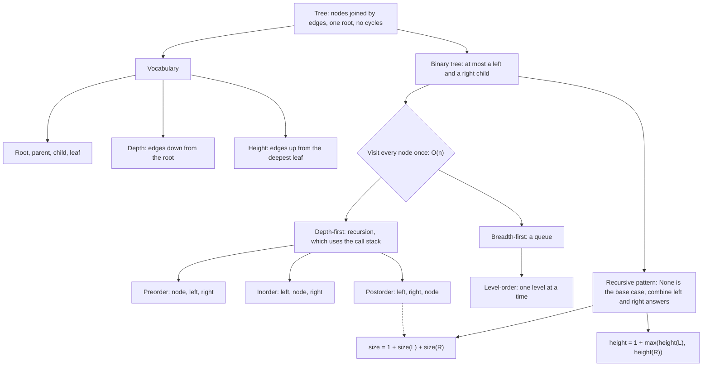

# Trees at a glance

**Takeaways**

- A tree is a **hierarchy**: one root, every other node has exactly one parent, and there are no cycles.
- **Depth** is measured from the root down; **height** from the deepest leaf up. With edge counting, a single node has height 0 and an empty tree height -1.
- The three **depth-first** orders differ only in *when* the node is visited relative to its two subtrees.
- **Level-order** swaps recursion for a **queue**, which processes nodes in order of depth.
- Almost every tree function is recursive: handle `None`, solve both subtrees, combine. That costs **O(n)** time and **O(h)** stack space.
