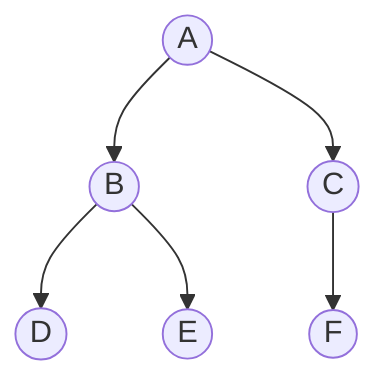

# Trees and traversals

A **tree** stores data as a hierarchy, like folders inside folders. It is made of **nodes** joined by **edges**: one node, the **root**, sits at the top, every other node has exactly one **parent**, and there are no cycles.



## Vocabulary

- **Children** are the nodes directly below a node: B and C are A's children.
- A **leaf** has no children (D, E, F). Other nodes are **internal**.
- The **depth** of a node is the number of edges from the root down to it (A has depth 0, F has depth 2).
- The **height** of a node is the number of edges on the longest path from it down to a leaf. The tree's height is the root's height: 2 here. (Some books count nodes instead, giving 3.)
- A **binary tree** gives each node at most two children, called **left** and **right**. Like a linked list, it is built from nodes that hold references:

```python
class Node:
    def __init__(self, key, left=None, right=None):
        self.key = key
        self.left = left      # left subtree (or None)
        self.right = right    # right subtree (or None)
```

## Traversals: visiting every node once

| Traversal | Order | Tree above |
|---|---|---|
| Preorder | node, left, right | A B D E C F |
| Inorder | left, node, right | D B E A C F |
| Postorder | left, right, node | D E B F C A |
| Level-order | level by level, left to right | A B C D E F |

The first three are **depth-first** recursions that differ only in where the "visit" line goes:

```python
def preorder(node):
    if node is None:          # base case: empty subtree
        return
    print(node.key)           # visit before the subtrees
    preorder(node.left)
    preorder(node.right)
```

**Level-order** is **breadth-first**: put the root in a **queue**, then repeatedly dequeue a node, visit it and enqueue its children.

## Height and size recursively

Most tree functions answer the empty tree directly and otherwise combine the answers for the two subtrees.

```python
def size(node):
    if node is None:
        return 0
    return 1 + size(node.left) + size(node.right)

def height(node):
    if node is None:
        return -1             # so that a single node has height 0
    return 1 + max(height(node.left), height(node.right))
```

## Cost

Every traversal visits each of the *n* nodes once: **O(n) time**. Recursive traversals use **O(h)** stack space, where *h* is the height; level-order needs room in the queue for the widest level.

## Common mistakes

- **Forgetting the `None` base case**, which crashes with `AttributeError` on the first missing child.
- **Mixing up depth and height**: depth is measured down from the root, height up from the leaves.
