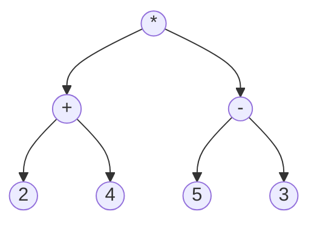

# Worked example: evaluating an expression tree

**Problem.** A calculator stores the expression `(2 + 4) * (5 - 3)` as a binary tree: operators are internal nodes, numbers are leaves. Write a function that computes its value, and see what the three depth-first traversals print for the same tree.

## Step 1: draw the tree

The operator applied *last* goes at the root. Here that is `*`; its left operand is `2 + 4` and its right operand is `5 - 3`.



## Step 2: build it in Python

```python
class Node:
    def __init__(self, key, left=None, right=None):
        self.key, self.left, self.right = key, left, right

expr = Node("*",
            Node("+", Node(2), Node(4)),
            Node("-", Node(5), Node(3)))
```

## Step 3: choose the traversal

To apply an operator you first need the values of **both** operands. So each node must be handled *after* its left and right subtrees: that is **postorder** (left, right, node).

## Step 4: write the recursive function

Base case: a leaf is a number, so return it. Recursive case: evaluate both subtrees, then combine them with the operator.

```python
def evaluate(node):
    if node.left is None and node.right is None:   # leaf: a number
        return node.key
    a = evaluate(node.left)                        # left subtree first
    b = evaluate(node.right)                       # then right subtree
    if node.key == "+":
        return a + b
    if node.key == "-":
        return a - b
    if node.key == "*":
        return a * b
    return a / b                                   # "/"
```

## Step 5: trace it

Rows are listed in the order the calls **finish**, which is exactly the postorder sequence.

| Finishes | Node | Left value | Right value | Returns |
|---|---|---|---|---|
| 1 | `2` | (leaf) | (leaf) | 2 |
| 2 | `4` | (leaf) | (leaf) | 4 |
| 3 | `+` | 2 | 4 | 6 |
| 4 | `5` | (leaf) | (leaf) | 5 |
| 5 | `3` | (leaf) | (leaf) | 3 |
| 6 | `-` | 5 | 3 | 2 |
| 7 | `*` | 6 | 2 | **12** |

`evaluate(expr)` returns **12**.

## Step 6: the other traversals

The same tree, walked in different orders, gives the three classic notations:

| Traversal | Output | Name |
|---|---|---|
| Preorder | `* + 2 4 - 5 3` | prefix (Polish) notation |
| Inorder | `2 + 4 * 5 - 3` | infix, but the brackets are lost |
| Postorder | `2 4 + 5 3 - *` | postfix (reverse Polish), what a stack calculator uses |

Careful with inorder: read without brackets, `2 + 4 * 5 - 3` means `2 + (4 * 5) - 3 = 19`, not 12. To print a correct infix expression you must put brackets around every operator's subtree: `((2 + 4) * (5 - 3))`.

## Step 7: cost

Each node is evaluated exactly once, so the time is **O(n)** for *n* nodes. The recursion is as deep as the tree is tall, so the extra space is **O(h)**: here *h* = 2.

**Try it yourself:** add a `count_operators(node)` function. Its base case returns 0 for a leaf; the recursive case returns `1 + count_operators(node.left) + count_operators(node.right)`.
