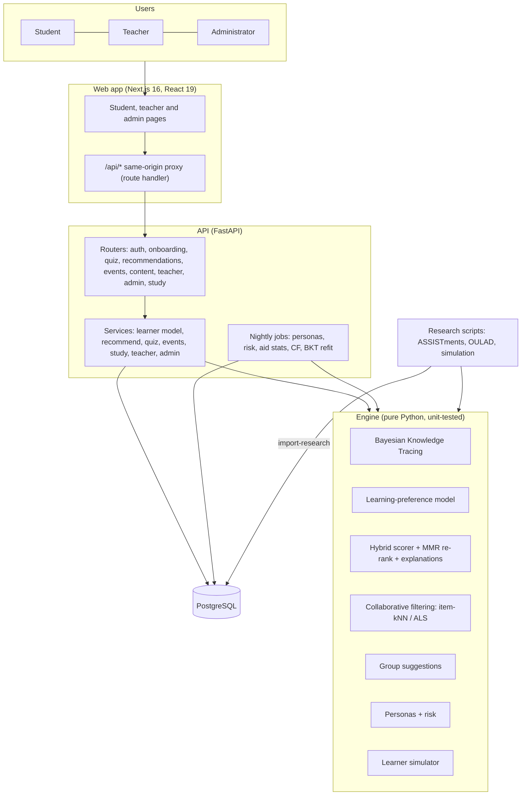
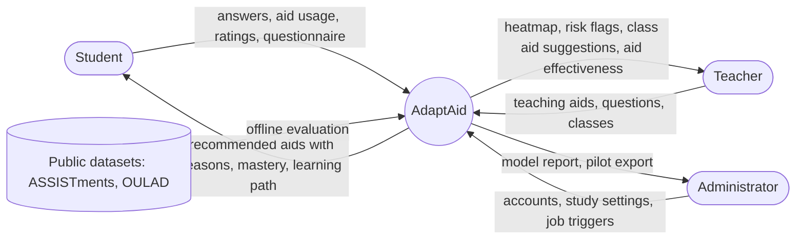
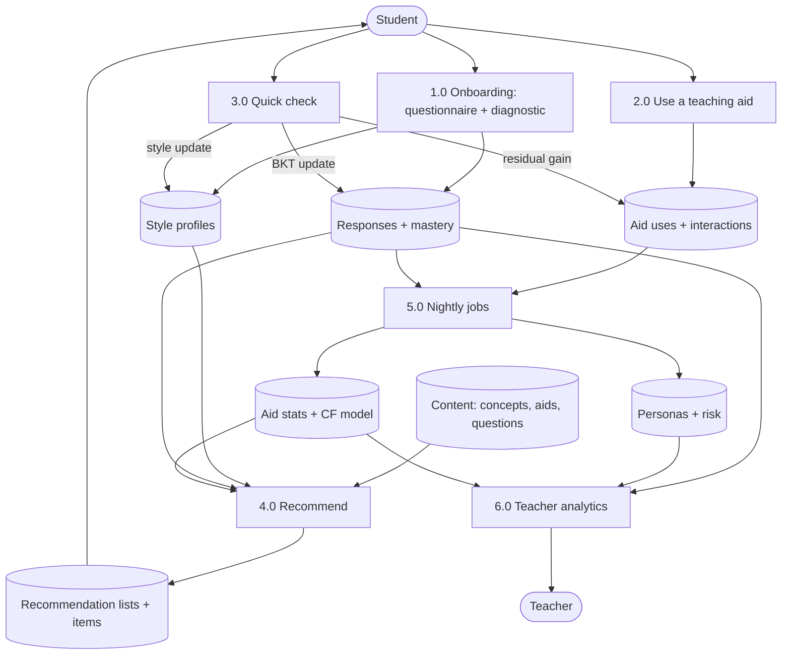
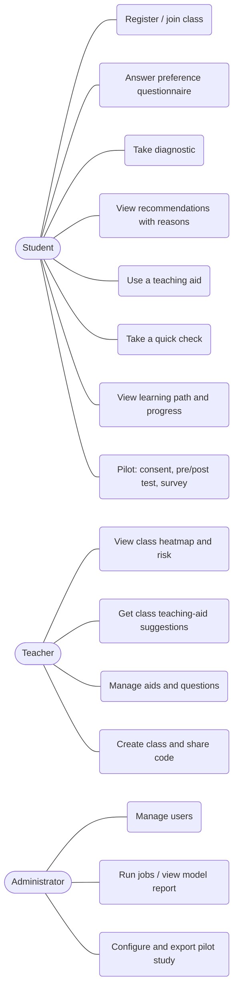
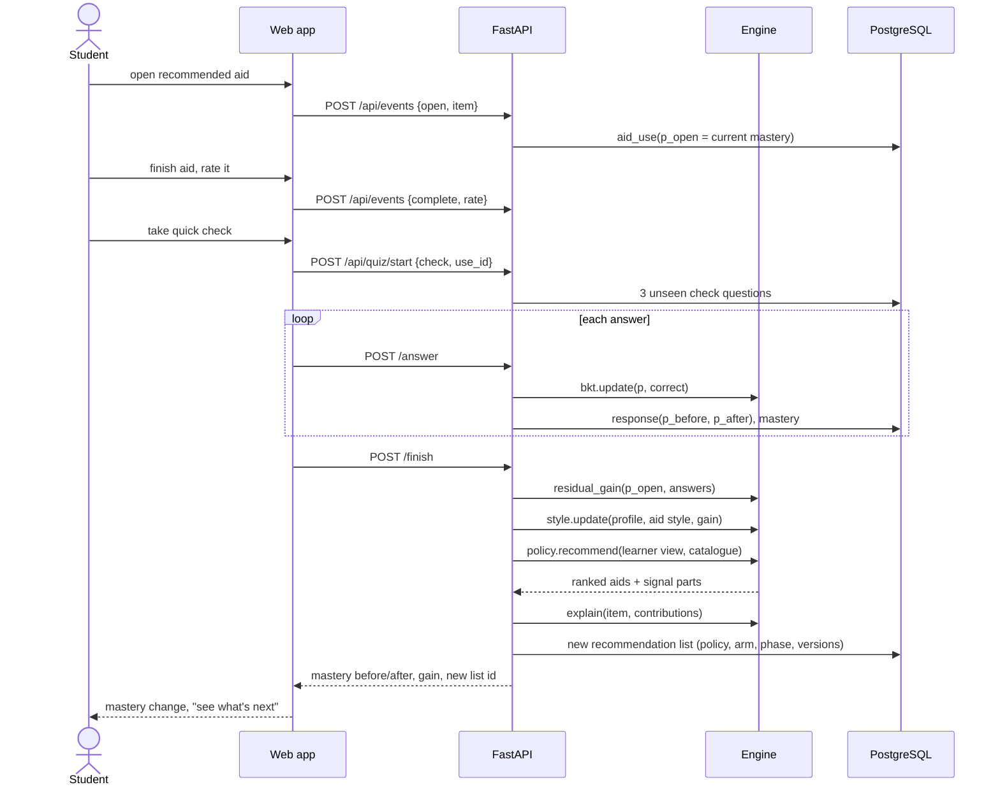
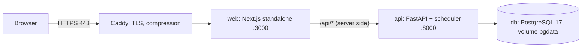

# System diagrams

All diagrams are Mermaid; GitHub, VS Code and https://mermaid.live render them, and they can be exported as PNG/SVG for the report.

## 1. Architecture

## 2. Data-flow diagram, level 0 (context)

## 3. Data-flow diagram, level 1

## 4. Use cases

## 5. Sequence: one turn of the adaptive loop

## 6. Deployment

